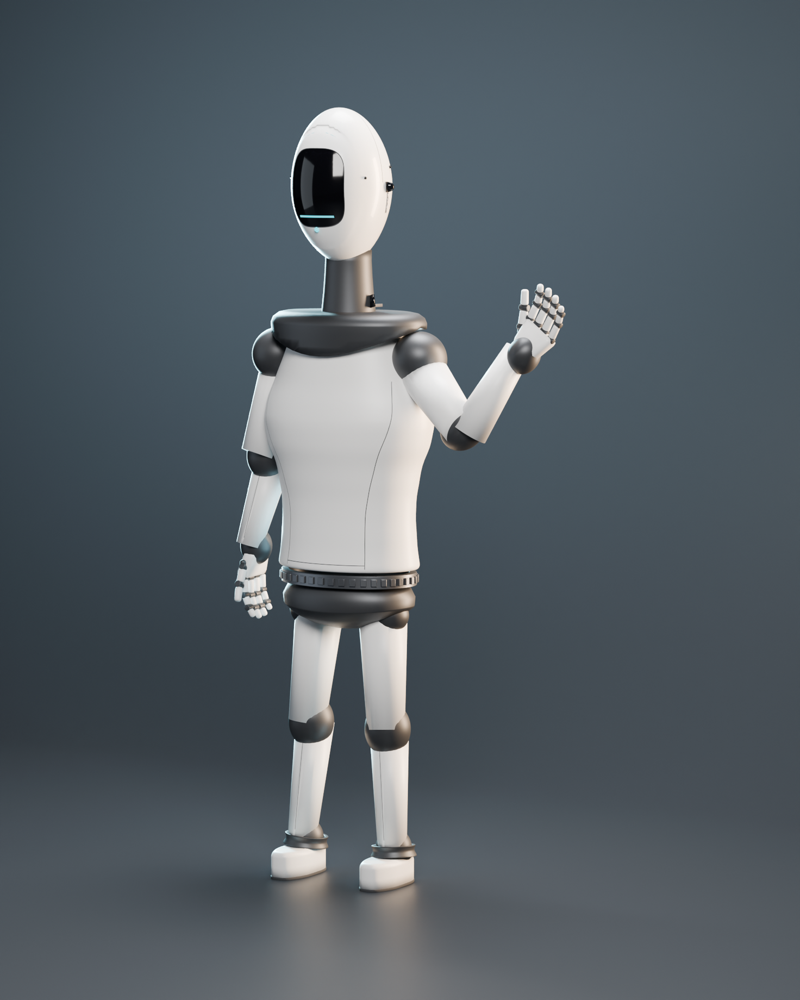
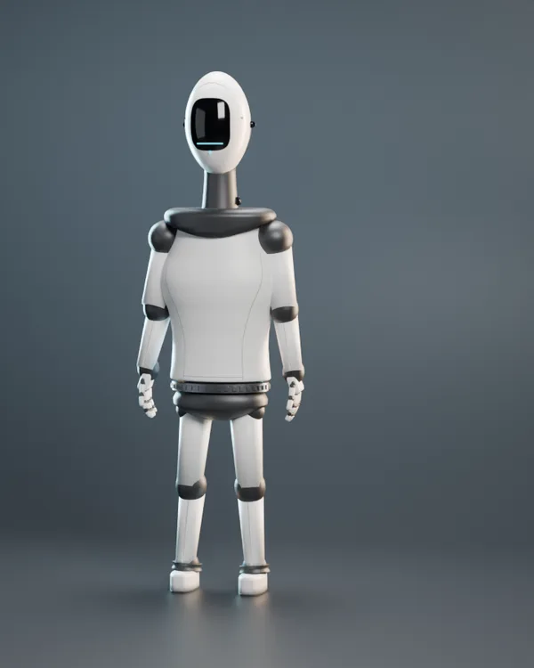
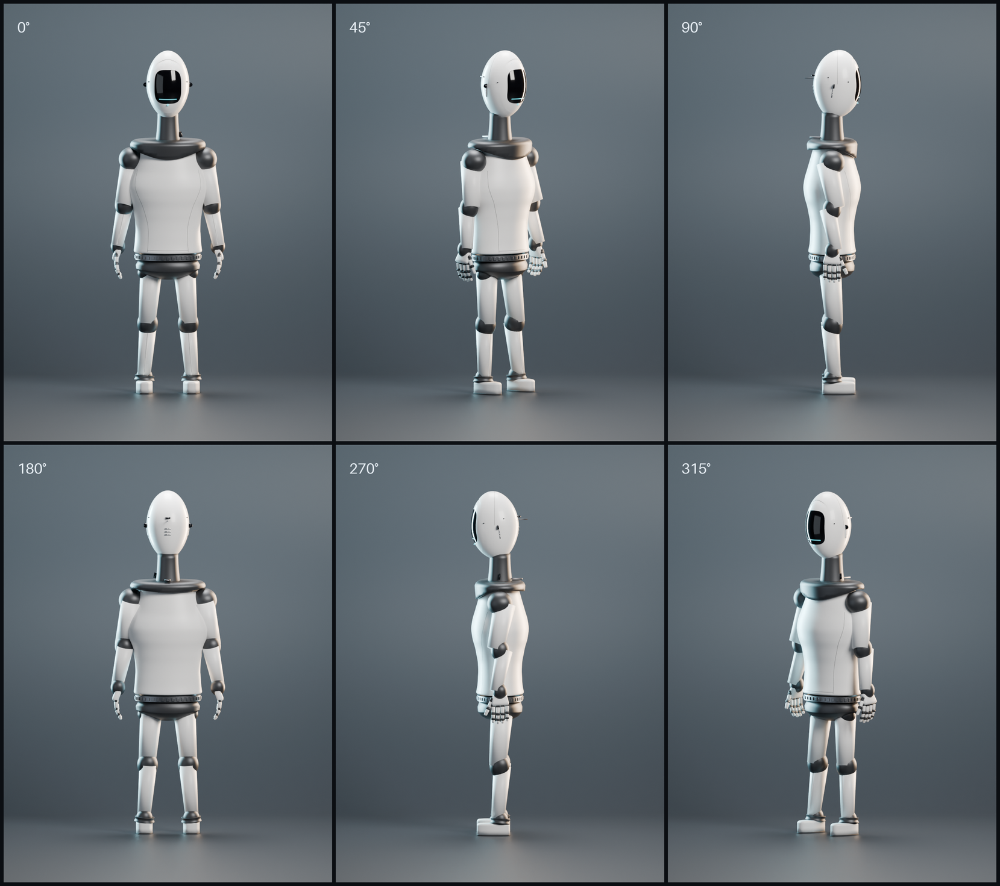
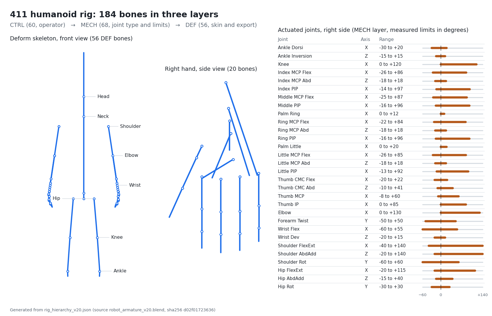

# Humanoid-Robot

A humanoid service robot built, rigged, checked and rendered with Blender Python: 184 bones in three layers, a read-only QA framework, and an export that is verified in Three.js.



| Pipeline Stage | Input | Python Entrypoint | Verified Output & Metric |
|---|---|---|---|
| Joint specification | Anatomy and mechanism notes | [`specifications/`](specifications/) | Arm, hand and leg joints each have a type, axes and limits in degrees. Head and neck have no spec yet |
| Rig and body build | Hand-modelled v16 scene | [`scripts/build/build_v20.py`](scripts/build/build_v20.py) | 184 bones: 56 DEF, 68 MECH, 60 CTRL. Zero-command deviation 0.0000° on all 56 deform bones |
| Rig data | v20 scene | [`scripts/showcase/extract_rig_hierarchy.py`](scripts/showcase/extract_rig_hierarchy.py) | [`proof/rig_hierarchy_v20.json`](proof/rig_hierarchy_v20.json), left and right DEF heads mirror within 2 mm |
| QA framework | Any scene, read-only | [`scripts/humanoid_qa/run_qa.py`](scripts/humanoid_qa/run_qa.py) | Geometry, symmetry, penetration and evidence code covered by 82 unit tests |
| GLB export | v20 scene | [`scripts/build/export_v18.py`](scripts/build/export_v18.py) | 56 DEF joints, 122 skinned meshes, export to reimport error at most 2.56e-6 m |
| Browser check | GLB + Blender reference | [`scripts/validation/threejs/run_viewer_test.mjs`](scripts/validation/threejs/run_viewer_test.mjs) | 2,296 bone positions in Three.js, worst error 1.79e-6 m ([report](proof/evidence_v20/viewer_test.md)) |
| Motion | Documented joint limits | [`scripts/showcase/wave_motion.py`](scripts/showcase/wave_motion.py) | 90-frame wave loop, 0 limit violations, hand travels 0.88 m |
| Showcase renders | v20 scene | [`scripts/showcase/render_showcase.py`](scripts/showcase/render_showcase.py) | Figure fills 75 to 82 % of frame height in every shot, measured twice |

## Motion



The wave is a pure function of the frame number. The elbow swings between 95° and 129° and the wrist follows by 9°; both stay inside the limits in [`specifications/arm/`](specifications/arm/). Full quality: [MP4](proof/03_hello_wave_motion.mp4).

## Views



## Rig



CTRL bones take input, MECH bones own joint type and limits, and DEF bones carry the skin. Only DEF bones are exported, because glTF has no constraints. The rules are in [`docs/ENGINEERING_RULES.md`](docs/ENGINEERING_RULES.md).

## Run it

```bash
git clone https://github.com/411tmnd-star/Humanoid-Robot && cd Humanoid-Robot
python -m unittest discover -s scripts/humanoid_qa/tests -t scripts   # 82 tests, standard library only
python -m unittest discover -s scripts/showcase/tests                 # 11 tests, standard library only
python -m pytest -q                                                   # the same 93 tests
python scripts/showcase/rig_diagram.py proof/rig_hierarchy_v20.json proof/04_rig_diagram.png   # needs matplotlib
```

Rebuilding or rendering the robot needs Blender 5.2 and the source scene, which is kept outside git. See [`scripts/build/README.md`](scripts/build/README.md).

## Two bugs worth reading

- **The hands were wrong and no check failed.** Early checks compared bone positions, not mesh shape. A POSE-space copy from bones with a different rest frame turned fingers by 17° to 178° at zero command. The fix and the mesh-based check are in [`docs/phase_v18_refine.md`](docs/phase_v18_refine.md).
- **A passing test that could not fail.** The first Three.js comparison passed for the wrong model too, because the measured boxes did not include the changed parts. Thigh, shin, pelvis and waist-band measurements were added, and the wrong model now fails. See [`docs/phase_v20_refine.md`](docs/phase_v20_refine.md).

## Limits

- The browser check ran in a software renderer. It proves loading, skinning and motion agree with Blender, not frame rate.
- The Blender fixture tests and the scene checks need Blender and are not part of the 93 tests above.
- This is a digital robot. No physical robot was built.

## Layout

| Folder | Contents |
|---|---|
| `scripts/rig/` | IK solvers, shoulder and hip builder, skinning |
| `scripts/build/` | Deterministic scene builders v17 to v20 and the GLB exporter |
| `scripts/humanoid_qa/` | Measurement and QA framework with its tests |
| `scripts/validation/` | Per-version validators and the Three.js viewer test |
| `scripts/showcase/` | Renders, motion, rig diagram and proof checks |
| `proof/` | Every published image, its data and [`PROOF_MANIFEST.json`](proof/PROOF_MANIFEST.json) |

Source-available for review only. See [LICENSE](LICENSE).
